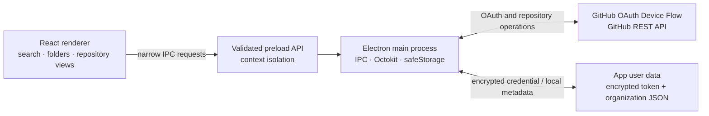

<div align="center">

# codexa

### A calmer way to work with GitHub.

Organize repositories like a desktop library. Keep your real GitHub repositories exactly where they are.

<br />


</div>

<br />

> **The idea:** your GitHub account is the source of truth for repositories. Codexa adds a private, local organization layer—folders, assignments, and favorites—without creating folders, moving repositories, or changing their names on GitHub.

---

## At a glance

| | |
|---|---|
| **Desktop** | Windows application built with Electron |
| **Frontend** | React, TypeScript, Vite, Tailwind CSS |
| **GitHub** | Octokit and the GitHub REST API |
| **Local data** | Organization metadata saved in the app's user-data folder |
| **Authentication** | GitHub OAuth Device Flow; token encrypted with Electron `safeStorage` |
| **Demo data** | None. The app does not show fabricated repositories. |

## Contents

- [Why Codexa](#why-codexa)
- [What works today](#what-works-today)
- [Security model](#security-model)
- [Architecture](#architecture)
- [Getting started](#getting-started)
- [Commands](#commands)
- [GitHub setup and permissions](#github-setup-and-permissions)
- [Local organization data](#local-organization-data)
- [Known limitations](#known-limitations)
- [Troubleshooting](#troubleshooting)
- [Contributing](#contributing)

## Why Codexa

GitHub is excellent at hosting code, but it is not a personal file manager. Codexa gives you a desktop view for browsing and grouping repositories while leaving their actual GitHub locations alone.

### Made for focused work

- **A folder-first library** — create nested virtual folders and move repositories with drag and drop.
- **Fast discovery** — search names, descriptions, languages, and topics; filter by visibility, archive status, forks, and recent activity.
- **Two ways to browse** — switch between a compact list and a repository card grid.
- **Useful context** — inspect default branch, language, visibility, stars, forks, topics, and dates without leaving the library.
- **Real actions, clear consequences** — edit repository details, manage topics, archive or unarchive, and change visibility with confirmation.
- **Your preferences stay yours** — favorites and folder organization are local to this Windows profile.

### A small interaction guide

| Action | How |
|---|---|
| Search | Use the search field or press `Ctrl+K` |
| Select multiple repositories | `Ctrl`-click / `Shift`-click; `Ctrl+A` selects the visible results |
| Move a repository | Drag it onto a folder, or select repositories and use **Move to folder** |
| Open the repository | Double-click a row or use **Open on GitHub** |
| Copy the HTTPS clone URL | Open a repository's details and choose **Copy HTTPS URL** |

## What works today

| Area | Available |
|---|---|
| Sign-in | OAuth Device Flow with an OAuth App client ID |
| Repository library | Lists repositories available to the signed-in user, including organization repositories the account can access |
| Organization | Create, nest, rename, and delete virtual folders; assign one folder per repository |
| Discovery | Search, list/grid views, sorting, visibility filters, archived/fork/recent filters |
| Repository details | Description, homepage, primary language, visibility, branch, dates, topics, stars, and forks |
| Repository actions | Edit name/description/homepage, replace topics, archive/unarchive, change public/private visibility |
| Multi-select | Review before moving folders, archiving/unarchiving, or changing visibility; per-repository failure reporting; export selected metadata as JSON |
| Local utilities | Favorites, export/restore organization JSON, copy clone URL, open on GitHub |

Repository actions are sent to GitHub. If GitHub rejects an action, Codexa reports the error and does not present it as successful. A folder move, by contrast, changes only local organization metadata.

## Security model

Codexa keeps the renderer deliberately separate from privileged operations:

1. **The renderer has no Node.js access.** Electron context isolation and sandboxing are enabled; Node integration is disabled.
2. **The preload exposes a small API.** The renderer can request specific operations through IPC, not arbitrary filesystem access or shell execution.
3. **IPC inputs are validated.** Data that reaches local persistence or GitHub actions is checked with Zod schemas.
4. **GitHub requests stay in the main process.** The access token is never returned to React or written to local storage.
5. **Tokens are encrypted at rest.** Electron `safeStorage` protects the access and refresh tokens. Device Flow refreshes short-lived access tokens when GitHub issues a refresh token; if a grant is revoked or refresh expires, Codexa asks you to sign in again.
6. **Organization data contains no credentials.** Folder names, assignments, and favorites are saved separately as JSON under Electron's app data directory.
7. **External navigation is restricted.** Only approved GitHub HTTPS links are opened through the system browser.

The OAuth App **client ID is public application configuration**, not a client secret. Do not add a client secret, private key, or access token to `.env`, source code, or a Vite-exposed variable. Codexa uses Device Flow and does not need an embedded OAuth client secret.

## Architecture



```text
electron/
  main/       GitHub auth, Octokit, IPC validation, safe local persistence
  preload/    typed, narrow renderer bridge
src/
  App.tsx     explorer interface and interaction flows
  shared/     app types, organization helpers, validation, tests
```

## Getting started

### Prerequisites

- Windows 10 or later
- [Node.js 22.12 or later](https://nodejs.org/) and npm
- A GitHub account
- A GitHub OAuth App with **Device Flow** enabled (see [GitHub setup](#github-setup-and-permissions))

### Install and run

```powershell
git clone <your-codexa-repository-url>
cd Codexa
npm install
Copy-Item .env.example .env
```

Edit `.env` and set your OAuth App's client ID:

```dotenv
GITHUB_CLIENT_ID=your-oauth-app-client-id
```

Then start the desktop app:

```powershell
npm run dev
```

Codexa opens the GitHub Device Flow page in your browser. Enter the one-time code shown in the app and approve access. Repository data is loaded only after GitHub authorizes the session.

> For a distributable installer, set `GITHUB_CLIENT_ID` before building. The client ID is compiled into the desktop main process as public configuration. Do not package a client secret.

## Commands

| Command | Purpose |
|---|---|
| `npm run dev` | Run the Electron app with Vite hot reload |
| `npm run build` | Type-check the project and create production bundles |
| `npm test` | Run local organization and validation tests |
| `npm run lint` | Lint the application and Electron sources |
| `npm run build:win` | Build and package the Windows NSIS installer |

The installer is written to `release/`. Set `GITHUB_CLIENT_ID` in `.env` before packaging; the packaging command fails early if it is missing. Building an installer may require an internet connection the first time Electron Builder downloads its packaging tools.

## GitHub setup and permissions

1. Open **GitHub → Settings → Developer settings → OAuth Apps** and create an OAuth App for Codexa.
2. Enable **Device Flow** in that app's settings.
3. If GitHub's registration form requests a callback URL, enter a local placeholder such as `http://localhost/callback`; Device Flow does not redirect to it.
4. Copy the OAuth App **Client ID** into the local `.env` file as `GITHUB_CLIENT_ID`.
5. Restart the dev app after changing `.env`; the value is injected by the Electron build configuration.
6. During sign-in, review the GitHub authorization screen before approving.

Codexa requests the OAuth scopes `repo read:user offline_access`:

| Scope | Used for |
|---|---|
| `read:user` | Confirm the signed-in account and display its login/avatar |
| `repo` | Read private repositories and perform repository actions such as editing metadata, topics, archive state, and visibility |
| `offline_access` | Request short-lived access tokens with rotating refresh tokens when supported |

`offline_access` lets Device Flow return rotating refresh tokens for expiring access tokens. The device-flow exchange and refresh do not require an OAuth client secret. See GitHub's [OAuth App authorization documentation](https://docs.github.com/en/apps/oauth-apps/building-oauth-apps/authorizing-oauth-apps#device-flow).

The `repo` scope is broad because the implemented write actions use GitHub's repository APIs. Organization owners may enforce SAML SSO or OAuth App restrictions; in that case, authorize the application for the organization or ask an administrator to approve it. Codexa cannot bypass organization policy.

To disconnect, use the account menu in the app. This removes Codexa's locally stored token; to revoke the OAuth grant itself, also remove Codexa from [GitHub's authorized applications](https://github.com/settings/applications).

## Local organization data

- Folders, nesting, favorites, and repository assignments are stored under Electron's per-user app-data directory.
- A repository can belong to one virtual folder at a time; nested folder views include repositories assigned to child folders.
- Repositories not assigned to a folder appear under **Uncategorized**.
- Deleting a folder removes its local assignments, not the GitHub repositories.
- **Export backup** and **Restore** work with organization JSON. The backup does not contain a GitHub access token.
- Signing out does not delete your local folder organization.

## Known limitations

Codexa is an early implementation, not a finished replacement for GitHub's website. The current build does not yet include:

- GitHub App authentication, fine-grained permission grants, or a hosted OAuth broker
- Bulk topic editing or custom saved filters/sort preferences
- SQLite storage, automatic background sync, or cross-device synchronization
- A setup wizard for OAuth App registration

There is no demo mode or fake repository fallback. A GitHub client ID and an authorized account are needed for live repository access. Do not interpret an available UI control as proof that an external GitHub permission or organization policy will allow an operation.

## Troubleshooting

<details>
<summary><strong>“Set GITHUB_CLIENT_ID in .env”</strong></summary>

Copy `.env.example` to `.env`, set the OAuth App client ID, and restart `npm run dev`. The value is read during the Electron build; it is not a renderer variable.
</details>

<details>
<summary><strong>GitHub does not show a device code or sign-in fails</strong></summary>

Verify that Device Flow is enabled for the OAuth App, that the client ID is correct, and that GitHub is reachable. If a code expires, start sign-in again. `authorization_pending` is expected while approval is still waiting.
</details>

<details>
<summary><strong>Private or organization repositories are missing</strong></summary>

Confirm the signed-in account can access the repository, that the OAuth grant includes the requested repository access, and that the organization permits this OAuth App. Complete any required SAML SSO authorization.
</details>

<details>
<summary><strong>An action is denied or rate limited</strong></summary>

The action may require repository admin access, organization approval, or a permission that the current account does not have. GitHub's rate limits also apply. Codexa surfaces API errors; retry after resolving the permission or limit.
</details>

<details>
<summary><strong>Secure storage is unavailable</strong></summary>

Codexa will not fall back to plaintext token storage. Use a supported Windows user session with Electron's `safeStorage` available, then restart the app.
</details>

## Contributing

Contributions should preserve the boundary between the renderer and privileged services. Keep credentials out of renderer code, validate new IPC payloads, and add tests for changes to local organization behavior. Before opening a pull request, run:

```powershell
npm test
npm run lint
npm run build
```

---

<div align="center">

**Keep the code on GitHub. Make the workspace your own.**

</div>
