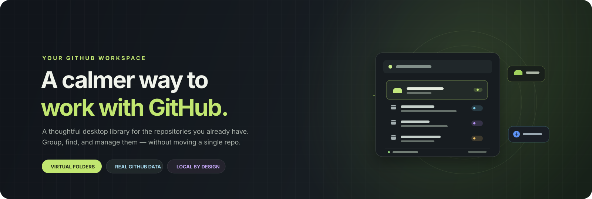
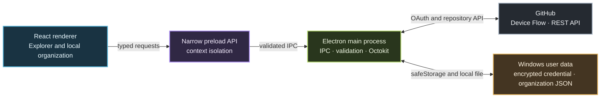

<div align="center">
  

  <br />

  <a href="#get-started"></a>
  <a href="#features"></a>
  <a href="#security-at-a-glance"></a>
  <a href="./LICENSE"></a>

  <br /><br />

  
  
  
  
  
  

  <p><strong>Keep the code on GitHub. Make the workspace your own.</strong></p>
</div>

<br />

> [!IMPORTANT]
> Codexa is in early development. It connects to your real GitHub account, but still has feature gaps. Review [what works](#feature-map) and [what is not implemented yet](#current-boundaries) before relying on it.

<table>
  <tr>
    <td width="50%">
      <h3>🗂️ Your repositories, organized</h3>
      <p>Browse repositories in a desktop library. Build nested virtual folders, mark favorites, and move between groups without changing anything on GitHub.</p>
    </td>
    <td width="50%">
      <h3>🔒 Your data, kept local</h3>
      <p>GitHub remains the source of truth. Folder organization stays in your Windows app data; credentials are protected by Electron's OS-backed secure storage.</p>
    </td>
  </tr>
</table>

<details>
  <summary><strong>Contents</strong></summary>

- [The idea](#the-idea)
- [Features](#features)
- [Feature map](#feature-map)
- [Security at a glance](#security-at-a-glance)
- [Architecture](#architecture)
- [Get started](#get-started)
- [GitHub setup and permissions](#github-setup-and-permissions)
- [Commands](#commands)
- [Your data and backups](#your-data-and-backups)
- [Current boundaries](#current-boundaries)
- [Troubleshooting](#troubleshooting)
- [Contributing](#contributing)
- [License](#license)
</details>

---

## The idea

GitHub hosts repositories; it does not provide arbitrary folders containing separate repositories. Codexa adds that missing personal organization layer **locally**, like a file manager for your GitHub library.

```text
Your GitHub account                    Codexa on this PC
────────────────────                   ───────────────────────────
Repositories, permissions,   ───────▶  Virtual folders and nesting
topics, visibility, metadata           Favorites and local assignments
                                       Search, filters, and views
```

> **A folder move is not a GitHub action.** It only changes a local repository-to-folder assignment. Codexa does not move, rename, delete, or create repositories when you organize folders.

## Features

<table>
  <tr>
    <td width="33%" valign="top">
      <h3>📁 Organize</h3>
      <ul>
        <li>Create nested virtual folders</li>
        <li>Drag repositories between folders</li>
        <li>Keep an Uncategorized view</li>
        <li>Favorite frequently used repos</li>
        <li>Back up and restore your folder data</li>
      </ul>
    </td>
    <td width="33%" valign="top">
      <h3>🔎 Find</h3>
      <ul>
        <li>Search names, descriptions, languages, and topics</li>
        <li>Filter by public/private, archived, forks, or recent</li>
        <li>Sort by name, language, dates, or visibility</li>
        <li>Choose list or grid view</li>
        <li>Select with Ctrl and Shift</li>
      </ul>
    </td>
    <td width="33%" valign="top">
      <h3>⚙️ Manage</h3>
      <ul>
        <li>Inspect repository details and statistics</li>
        <li>Edit name, description, and homepage</li>
        <li>Replace repository topics</li>
        <li>Archive and unarchive</li>
        <li>Change visibility with a review step</li>
      </ul>
    </td>
  </tr>
</table>

### Keyboard and mouse

| Do this | To do this |
|---|---|
| `Ctrl+K` | Focus repository search |
| `Ctrl+A` | Select all currently visible repositories |
| `Ctrl`-click | Add or remove one repository from selection |
| `Shift`-click | Select a range |
| `Esc` | Clear the current selection |
| Double-click a repository | Open it on GitHub |
| Drag a repository onto a folder | Move it in the local organization |

## Feature map

| Capability | Current support |
|---|---|
| Sign in with GitHub | OAuth Device Flow using your OAuth App client ID |
| Load repositories | Repositories the signed-in user can access, including organization repositories permitted by GitHub |
| Virtual organization | Create, nest, rename, delete, assign, and drag/drop repositories into folders |
| Repository discovery | Live search, filters, list and grid views, sortable columns |
| Repository detail | Description, homepage, owner, branch, language, topics, visibility, stars, forks, and dates |
| GitHub actions | Edit repository metadata, replace topics, archive/unarchive, change public/private visibility |
| Bulk work | Review before move, archive/unarchive, or visibility changes; report per-repository failures |
| Local utilities | Favorites, backup/restore organization JSON, copy HTTPS clone URL, open on GitHub |
| Demo data | None; Codexa does not pass off sample repositories as live account data |

GitHub is authoritative for repository changes. When an API request fails, Codexa surfaces the failure instead of reporting a false success. Actions may be unavailable to accounts without the required repository permissions or organization approval.

## Security at a glance

<table>
  <tr>
    <th align="left">🔐 Boundary</th>
    <th align="left">How Codexa handles it</th>
  </tr>
  <tr>
    <td><strong>Renderer</strong></td>
    <td>Node.js integration is disabled. Context isolation and Electron renderer sandboxing are enabled.</td>
  </tr>
  <tr>
    <td><strong>Preload / IPC</strong></td>
    <td>The renderer receives a narrow set of typed IPC methods. Inputs are validated before local writes or repository actions.</td>
  </tr>
  <tr>
    <td><strong>GitHub token</strong></td>
    <td>OAuth and Octokit calls run in the Electron main process. The token is not exposed to React or written to local storage.</td>
  </tr>
  <tr>
    <td><strong>Credential at rest</strong></td>
    <td>Access and refresh tokens are encrypted using Electron <code>safeStorage</code>. If encryption is unavailable, Codexa refuses to save a token.</td>
  </tr>
  <tr>
    <td><strong>Local organization</strong></td>
    <td>Folder names, assignments, and favorites are stored as JSON in the app's per-user data directory, separately from credentials.</td>
  </tr>
  <tr>
    <td><strong>External links</strong></td>
    <td>External pages open in the system browser; navigation from the app window is restricted.</td>
  </tr>
</table>

The OAuth App **client ID is public application configuration**. Do not put an OAuth client secret, private key, or access token in source code, `.env`, or renderer-exposed Vite variables. Codexa uses Device Flow and does not embed a client secret.

### Architecture



```text
electron/
  main/       Auth, Octokit, IPC validation, safe local persistence
  preload/    Narrow typed bridge to the renderer
src/
  App.tsx     Repository explorer and interaction flows
  shared/     Data types, organization helpers, schemas, tests
scripts/      Build-time OAuth configuration check
docs/         README artwork
```

## Get started

### Requirements

- Windows 10 or later
- [Node.js 22.12 or later](https://nodejs.org/) and npm
- A GitHub account
- A GitHub OAuth App with **Device Flow enabled** ([setup below](#github-setup-and-permissions))

### Install and run

```powershell
git clone <your-codexa-repository-url>
cd Codexa
npm install
Copy-Item .env.example .env
```

Set your OAuth App client ID in `.env`:

```dotenv
GITHUB_CLIENT_ID=your-oauth-app-client-id
```

Launch Codexa:

```powershell
npm run dev
```

The app opens GitHub's Device Flow page in your browser and displays a one-time code. Enter the code, review the permission request, and authorize Codexa. Your repositories are fetched only after successful authorization.

> **Installer builds require the client ID.** Set `GITHUB_CLIENT_ID` in `.env` before running `npm run build:win`. The packaging command checks this configuration before building. The client ID is public configuration; never package a client secret.

## GitHub setup and permissions

1. In GitHub, open **Settings → Developer settings → OAuth Apps** and create an OAuth App for Codexa.
2. Enable **Device Flow** in the OAuth App settings.
3. If GitHub asks for a callback URL, use a local placeholder such as `http://localhost/callback`; Device Flow does not redirect to it.
4. Put the OAuth App **Client ID** in `.env` as `GITHUB_CLIENT_ID`.
5. Restart the dev app after changing `.env`.
6. During sign-in, review the permissions on GitHub before approving.

Codexa requests:

| Scope | Why it is requested |
|---|---|
| `read:user` | Confirm the signed-in account and display its login and avatar |
| `repo` | Read private repositories and perform repository actions such as editing metadata, topics, archive state, and visibility |
| `offline_access` | Request short-lived access tokens and rotating refresh tokens when supported |

The `repo` scope is broad because the app includes repository write actions. Organization owners may restrict OAuth Apps or require SAML SSO authorization; Codexa cannot bypass those policies. See GitHub's [Device Flow documentation](https://docs.github.com/en/apps/oauth-apps/building-oauth-apps/authorizing-oauth-apps#device-flow) for the current OAuth flow details.

Signing out removes Codexa's locally stored token. To revoke the OAuth grant too, remove Codexa from [GitHub's authorized applications](https://github.com/settings/applications).

## Commands

| Command | What it does |
|---|---|
| `npm run dev` | Start the Electron app with Vite hot reload |
| `npm run build` | Type-check and create production bundles |
| `npm test` | Run local organization and validation tests |
| `npm run lint` | Lint renderer and Electron sources |
| `npm run build:win` | Build and package the Windows NSIS installer |

The installer is written to `release/`. The first installer build may download Electron Builder packaging tools and therefore requires internet access.

## Your data and backups

| Data | Where it lives | Included in backup? |
|---|---|---|
| OAuth access/refresh tokens | Encrypted file in Electron's per-user app-data directory | **No** |
| Virtual folders and nesting | Local organization JSON in app data | **Yes** |
| Repository-to-folder assignments | Local organization JSON in app data | **Yes** |
| Favorites | Local organization JSON in app data | **Yes** |
| Repository metadata | Fetched from GitHub when the app syncs | Not part of organization backup |

- Each repository belongs to one virtual folder at a time; a folder view also shows repositories assigned to nested folders.
- Repositories without a folder appear in **Uncategorized**.
- Deleting a folder removes its local assignments. It does **not** delete repositories from GitHub.
- Use **Export backup** and **Restore** in the sidebar to save or restore organization JSON.
- Signing out does not delete your local organization.

## Current boundaries

Codexa is an early implementation, not a complete replacement for GitHub. These capabilities are not included yet:

- GitHub App authentication, fine-grained app permissions, or a hosted OAuth broker
- Bulk topic editing and custom saved filters/sort preferences
- SQLite storage, automatic background sync, and cross-device organization sync
- A guided OAuth App setup wizard

There is no demo mode or fake repository fallback. Live repository access requires a configured OAuth client ID and an account that authorizes the app. Review available GitHub permissions before performing consequential actions.

## Troubleshooting

<details>
  <summary><strong>“Set GITHUB_CLIENT_ID in .env”</strong></summary>

Copy `.env.example` to `.env`, enter the OAuth App client ID, and restart `npm run dev`. The value is main-process configuration, not a renderer variable.
</details>

<details>
  <summary><strong>GitHub sign-in fails or the code expires</strong></summary>

Check that Device Flow is enabled, the client ID is correct, and GitHub is reachable. If the code expires, start sign-in again. `authorization_pending` is expected while approval is still waiting.
</details>

<details>
  <summary><strong>A private or organization repository is missing</strong></summary>

Make sure the signed-in account can access it, the OAuth grant includes repository access, and the organization permits this OAuth App. Complete any required SAML SSO authorization.
</details>

<details>
  <summary><strong>A GitHub action is denied or rate limited</strong></summary>

The account may lack repository admin permission, or an organization policy may block the OAuth App. GitHub rate limits also apply. Codexa reports the API error; resolve the permission or rate limit before trying again.
</details>

<details>
  <summary><strong>Secure storage is unavailable</strong></summary>

Codexa will not fall back to plaintext token storage. Use a supported Windows user session with Electron `safeStorage` available, then restart the app.
</details>

## Contributing

Preserve the renderer/main-process security boundary. Keep secrets out of the renderer, validate new IPC payloads, and add tests for changes to local organization behavior. Before opening a pull request, run:

```powershell
npm test
npm run lint
npm run build
```

## License

Codexa is licensed under the **MIT License**. See the complete terms in [`LICENSE`](./LICENSE).

---

<div align="center">
  <sub>Built for a tidier repository library — not a different GitHub.</sub>
</div>
